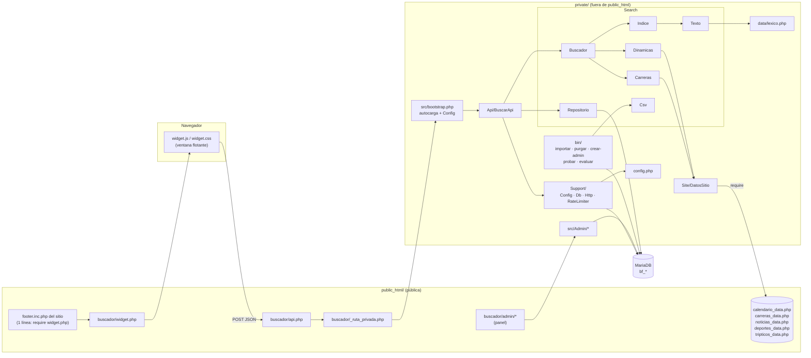
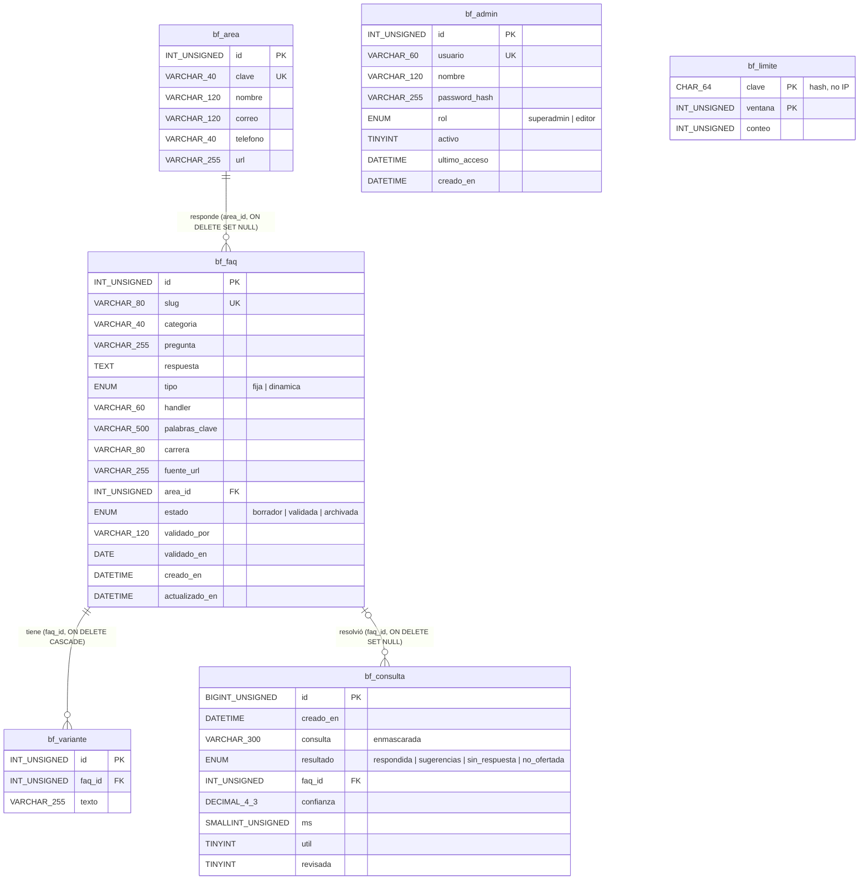

# 02 · Manual técnico

## 1. Arquitectura

Todo es PHP (7.4 y 8.x) sin dependencias externas. No hay procesos en segundo plano: cada petición carga las preguntas desde MariaDB, construye un índice en memoria (unos milisegundos con ~150 preguntas) y responde.



| Componente | Archivo | Responsabilidad |
|---|---|---|
| Endpoint | `public_html/buscador/api.php` → `private/src/Api/BuscarApi.php` | CORS, método, JSON, límite por minuto, validación, registro anónimo de la consulta |
| Buscador | `private/src/Search/Buscador.php` | Orquesta: carrera, corrección, calificación, ajuste por carrera, umbrales y decisión. No toca la base de datos (se prueba sin MariaDB). |
| Indice | `private/src/Search/Indice.php` | Índice en memoria: frecuencias ponderadas, idf, frases (pregunta y variantes), corrección por distancia de edición, calificación |
| Texto | `private/src/Search/Texto.php` | Normalización, expansiones, frases, palabras vacías, sinónimos, plegado fonético y raíz |
| Carreras | `private/src/Search/Carreras.php` | Carreras activas (de `carreras_data.php`), alias coloquiales y carreras no ofertadas |
| Dinamicas | `private/src/Search/Dinamicas.php` | Respuestas armadas en vivo con los datos del sitio (7 *handlers*) |
| DatosSitio | `private/src/Site/DatosSitio.php` | Lee los `*_data.php` del sitio con `require` en un ámbito aislado |
| Repositorio | `private/src/Search/Repositorio.php` | Lectura de preguntas y variantes desde MariaDB |
| Csv | `private/src/Search/Csv.php` | Lectura de `conocimiento/*.csv` (con BOM de Excel) |
| Soporte | `private/src/Support/*` | Configuración, PDO con consultas preparadas, respuestas JSON, CORS, huella anónima, límite de solicitudes |
| Léxico | `private/data/lexico.php` | Abreviaturas, frases, sinónimos, palabras vacías, alias de carreras y carreras no ofertadas. Lo edita el área de sistemas sin tocar el motor. |

## 2. Modelo de datos

Generado a partir de `database/schema.sql` (MariaDB 10.11, InnoDB, `utf8mb4_unicode_ci`).



`bf_admin` y `bf_limite` no tienen relaciones: la primera guarda las cuentas del panel (solo el hash de la contraseña) y la segunda los contadores del límite de solicitudes (clave = SHA-256 de ámbito + huella; ventana = minuto).

## 3. Endpoint `POST /buscador/api.php`

- Solo `POST` con cuerpo JSON (máximo 8 KB). `OPTIONS` responde 204 al *preflight* de un origen permitido.
- Si llega cabecera `Origin`, debe estar en `seguridad.origenes_permitidos` (nunca `*`). Sin `Origin` (petición del mismo sitio) se acepta.
- Todas las respuestas son JSON con `Content-Type: application/json; charset=utf-8`, `X-Content-Type-Options: nosniff` y `Cache-Control: no-store`.

| Código | Cuándo |
|---|---|
| 200 | Correcto |
| 204 | *Preflight* `OPTIONS` |
| 400 | Cuerpo que no es un objeto JSON, o acción desconocida |
| 403 | Origen no permitido |
| 404 | `ver` con un id inexistente |
| 405 | Método distinto de POST/OPTIONS |
| 422 | Consulta vacía o de más de `seguridad.max_longitud` (300) caracteres |
| 429 | Más de `seguridad.limite_por_minuto` (20) solicitudes por minuto del mismo visitante |
| 500 | Error interno (el detalle va al log, nunca a la respuesta) |

Los ejemplos siguientes son **reales**: se obtuvieron con el servidor embebido de PHP 7.4 contra la base `bf_pruebas` cargada con `tests/fixtures/conocimiento/*.csv` y los datos simulados de `tests/fixtures/site_data/`. Las respuestas `[PENDIENTE: …]` son el texto de prueba de esas preguntas, no datos de la institución.

### 3.1 `buscar` → respondida

```http
POST /buscador/api.php HTTP/1.1
Origin: https://utypcb.edu.mx
Content-Type: application/json

{"accion":"buscar","consulta":"cuanto cuesta la inscripcion","contexto":{"carrera":null}}
```

```http
HTTP/1.1 200 OK
Access-Control-Allow-Origin: https://utypcb.edu.mx
Vary: Origin
Access-Control-Allow-Methods: POST, OPTIONS
Access-Control-Allow-Headers: Content-Type
Content-Type: application/json; charset=utf-8
X-Content-Type-Options: nosniff
Cache-Control: no-store

{"ok":true,"resultado":"respondida","respuesta":{"id":9,"pregunta":"¿Cuánto cuesta la inscripción?","texto":"[PENDIENTE: monto oficial validado por Servicios Escolares]","fuente":"https://utypcb.edu.mx/","area":"Servicios Escolares","validada":false,"enlaces":[]},"sugerencias":[{"id":10,"pregunta":"¿Qué requisitos necesito para el examen de admisión?","confianza":0.4}],"canalizar":null,"contexto":{"carrera":null},"confianza":1,"faq_id":9,"ms":1,"consulta_id":22}
```

### 3.2 `buscar` con carrera y contexto entre mensajes

```json
{"accion":"buscar","consulta":"informacion de la carrera de civil"}
```

```json
{"ok":true,"resultado":"respondida","respuesta":{"id":2,"pregunta":"¿De qué trata la carrera?","texto":"Ingeniería Civil\nIncluye: Técnico Superior Universitario en Construcción.\nNivel: TSU y licenciatura.","fuente":"https://utypcb.edu.mx/plan_estudios.php","area":"Dirección Académica","validada":false,"enlaces":[{"titulo":"Plan de estudios","url":"https://utypcb.edu.mx/plan_estudios.php"},{"titulo":"Tríptico: Ingeniería Civil","url":"https://utypcb.edu.mx/docs/tripticos/civil.pdf"}]},"sugerencias":[{"id":1,"pregunta":"¿Qué carreras ofrece la universidad?","confianza":0.639},{"id":8,"pregunta":"¿Dónde descargo el tríptico de la carrera?","confianza":0.518}],"canalizar":null,"contexto":{"carrera":"ingenieria-civil"},"confianza":0.738,"faq_id":2,"ms":1,"consulta_id":23}
```

El widget reenvía el `contexto` recibido en la siguiente pregunta:

```json
{"accion":"buscar","consulta":"y el triptico?","contexto":{"carrera":"ingenieria-civil"}}
```

```json
{"ok":true,"resultado":"respondida","respuesta":{"id":8,"pregunta":"¿Dónde descargo el tríptico de la carrera?","texto":"Aquí está el tríptico de la carrera:","fuente":"https://utypcb.edu.mx/plan_estudios.php","area":"Servicios Escolares","validada":false,"enlaces":[{"titulo":"Tríptico: Ingeniería Civil","url":"https://utypcb.edu.mx/docs/tripticos/civil.pdf"}]},"sugerencias":[],"canalizar":null,"contexto":{"carrera":"ingenieria-civil"},"confianza":0.905,"faq_id":8,"ms":1,"consulta_id":24}
```

### 3.3 `buscar` → sugerencias

```json
{"accion":"buscar","consulta":"examen"}
```

```json
{"ok":true,"resultado":"sugerencias","respuesta":null,"sugerencias":[{"id":5,"pregunta":"¿Cuándo son las evaluaciones finales?","confianza":0.777},{"id":10,"pregunta":"¿Qué requisitos necesito para el examen de admisión?","confianza":0.769}],"canalizar":null,"contexto":{"carrera":null},"confianza":0.777,"faq_id":null,"ms":1,"consulta_id":25}
```

### 3.4 `buscar` → no_ofertada

```json
{"accion":"buscar","consulta":"tienen enfermeria?"}
```

```json
{"ok":true,"resultado":"no_ofertada","respuesta":{"id":null,"pregunta":"¿Ofrecen Enfermería?","texto":"Por ahora la universidad no ofrece la carrera de Enfermería.\nEstas son las carreras disponibles:\n• Ingeniería Civil\n• Licenciatura en Comercio Internacional y Aduanas\n• Ingeniería en Energía y Desarrollo Sostenible\n• Ingeniería en Tecnologías de la Información e Innovación Digital\n• Licenciatura en Ingeniería en Manejo de Recursos Naturales","fuente":"https://utypcb.edu.mx/plan_estudios.php","area":null,"validada":true,"enlaces":[]},"sugerencias":[],"canalizar":null,"contexto":{"carrera":null},"confianza":1,"faq_id":null,"ms":1,"consulta_id":26}
```

### 3.5 `buscar` → sin_respuesta

```json
{"accion":"buscar","consulta":"a como esta el dolar"}
```

```json
{"ok":true,"resultado":"sin_respuesta","respuesta":null,"sugerencias":[],"canalizar":{"nombre":"Servicios Escolares","correo":"","telefono":"","url":"https://utypcb.edu.mx/contacto.php"},"contexto":{"carrera":null},"confianza":0,"faq_id":null,"ms":1,"consulta_id":27}
```

### 3.6 `ver`, `util` e `inicio`

```json
{"accion":"ver","id":11}
→ {"ok":true,"resultado":"respondida","respuesta":{"id":11,"pregunta":"¿Qué becas puedo solicitar?","texto":"[PENDIENTE: becas vigentes validadas por el área]","fuente":"https://utypcb.edu.mx/","area":"Servicios Escolares","validada":false,"enlaces":[]},"sugerencias":[],"canalizar":null,"contexto":{"carrera":null},"confianza":1,"faq_id":11}

{"accion":"util","consulta_id":1,"util":1}
→ {"ok":true}

{"accion":"inicio"}
→ {"ok":true,"sugerencias":[{"id":11,"pregunta":"¿Qué becas puedo solicitar?"},{"id":9,"pregunta":"¿Cuánto cuesta la inscripción?"},{"id":2,"pregunta":"¿De qué trata la carrera?"},{"id":8,"pregunta":"¿Dónde descargo el tríptico de la carrera?"}]}
```

`inicio` devuelve las 4 preguntas más consultadas en los últimos 30 días, para mostrarlas al abrir el widget.

### 3.7 Errores

```http
GET /buscador/api.php            → 405 {"ok":false,"error":"Método no permitido."}
POST con Origin ajeno            → 403 {"ok":false,"error":"Origen no permitido."}
POST con cuerpo "{no es json"    → 400 {"ok":false,"error":"Solicitud inválida."}
POST {"consulta":""}             → 422 {"ok":false,"error":"Escribe una pregunta de hasta 300 caracteres."}
21.ª solicitud en el mismo minuto → 429 {"ok":false,"error":"Demasiadas consultas. Espera un minuto e inténtalo de nuevo."}
```

## 4. El motor paso a paso

Entrada: la consulta (ya sin etiquetas HTML y con espacios normalizados por el endpoint) y el contexto anterior (`{"carrera": slug|null}`).

### 4.1 Normalización (`Texto::normalizar`)

Minúsculas (`mb_strtolower`), sin acentos ni diéresis (`á→a`, `ñ→n`, `ü→u`), todo lo que no sea letra o dígito se vuelve espacio (signos, emojis), letras repetidas 3 o más veces se reducen a una ("holaaaa" → "hola"; "carrera" se conserva) y espacios simples.

### 4.2 Expansiones y frases (`Texto::palabras`)

1. **Expansiones** palabra por palabra (`lexico.php › expansiones`): "q"→que, "info"→informacion, "kiero"→quiero, "ing"→ingenieria, "cuatri"→cuatrimestre, "compu"→computacion…
2. **Frases** sobre el texto completo (`lexico.php › frases`): "cuanto cuesta"/"cuanto cobran"→costo, "a que hora"→horario, "donde queda"→ubicacion, "servicio social"→serviciosocial, "mapa curricular"/"materias"→planestudios, "kardex"→historial…

### 4.3 Palabras vacías

Se descartan las palabras de `lexico.php › vacias` (artículos, saludos, "quiero", "saber", "universidad", "informacion"…). También se comparan en forma fonética, así "kiero" se descarta igual que "quiero".

### 4.4 Sinónimos

Cada grupo de `lexico.php › sinonimos` se reduce a su primera palabra: "precio", "colegiatura", "cuota", "mensualidad" → costo; "papeles", "documentos", "piden" → requisito; "folleto" → triptico; "futbol", "torneo" → deporte.

### 4.5 Plegado fonético (`Texto::fonetica`)

Reglas en orden: `ch` se protege; `ll→y`, `qu→k`, `ce/ci→se/si`, `ge/gi→je/ji`, `v→b`, `z→s`, `w→u`; después `c→k`, `h` muda se elimina, se restaura `ch` y se reducen letras dobles. Ejemplos: vacaciones→bakasiones, quiero→kiero, llave→yabe, geminis→jeminis, carreras→kareras. Los números no se tocan.

### 4.6 Raíz ligera (`Texto::raiz`)

Quita plurales (`-ses`→`-s`, `-es` tras consonante, `-s`) y trunca a 6 letras: kostos→kosto, papeles→papel, inskripsion→inskri. Así "beca" y "becas" (y "veca") llegan al mismo término `beka`.

### 4.7 Corrección por distancia de edición (`Indice::corregir`)

Al construir el índice se guarda, para cada palabra plegada completa del vocabulario (preguntas, variantes y palabras clave), su raíz. Si un término de la consulta **no** está en el índice, tiene 4 o más letras y no es número, se busca la palabra del vocabulario más parecida con `levenshtein()`:

- misma letra inicial;
- máximo 1 edición hasta 6 letras, 2 ediciones desde 7 letras;
- diferencia de longitud dentro de ese máximo.

Ejemplo real: "inscrpcion" → plegada `inskrpsion` → corregida a la raíz `inskri` (de "inscripcion"). "tripitco" → `tripti`.

### 4.8 Calificación (`Indice::calificar`)

Cada pregunta frecuente se indexa con pesos: pregunta ×2.0, variantes ×1.0, palabras clave ×1.5. Con N preguntas y df(t) = número de preguntas que contienen el término:

- idf(t) = ln(1 + (N − df + 0.5) / (df + 0.5)) (forma BM25).
- Un término desconocido pesa la mitad del idf promedio (resta cobertura, pero menos que un término muy específico).

Para la consulta Q (términos únicos) y cada pregunta P que comparta al menos un término:

- **cobertura** = Σ idf(t ∈ Q ∩ P) / Σ idf(t ∈ Q)
- **mejor variante** = máximo, sobre la pregunta, cada variante y pregunta+palabras clave, del coeficiente de Dice ponderado por idf: 2·Σidf(común) / (Σidf(Q) + Σidf(variante))
- **BM25** (k1 = 1.2, b = 0.75), normalizado contra el máximo de esa consulta, solo como desempate

**confianza = min(1, 0.55 · cobertura + 0.45 · mejor variante + 0.01 · BM25 normalizado)**

### 4.9 Ajuste por carrera (`Buscador::ajustarPorCarrera`)

Si hay carrera (mencionada o heredada del contexto):

- pregunta de **esa** carrera: +0.15 (máx. 1);
- pregunta de **otra** carrera: ×0.5;
- pregunta genérica con *handler* `carrera_detalle`: +0.10.

Sin carrera, las preguntas propias de una carrera se multiplican por 0.85.

### 4.10 Umbrales y decisión

Con `busqueda.umbral_respuesta` = 0.62 y `busqueda.umbral_sugerencias` = 0.30 (configurables):

1. Si la consulta menciona una carrera **no ofertada** y no hay carrera activa → `no_ofertada` (confianza 1).
2. Si no quedó ningún término → `sin_respuesta` con contacto general.
3. Si mejor ≥ 0.62 **y** (mejor − segunda ≥ 0.04 **o** mejor ≥ 0.85) → `respondida`, más hasta 2 relacionadas con confianza ≥ 0.30.
4. Si mejor ≥ 0.30 → `sugerencias`: hasta `max_sugerencias` (3) con confianza ≥ 0.24.
5. Si no → `sin_respuesta`. Si la mejor coincidencia llega a 0.15 se canaliza a **su** área; si no, a Servicios Escolares (`contacto_general`).

### 4.11 Ejemplo trabajado (números reales impresos por el motor)

Base: las 12 preguntas de `tests/fixtures/conocimiento/preguntas.csv` (N = 12, longitud media 16.25). Consulta: **"Kiero saber q rekisitos piden pa la fixa d admision"**.

| Paso | Resultado |
|---|---|
| Normalizar | `kiero saber q rekisitos piden pa la fixa d admision` |
| Expansiones | kiero→quiero, q→que, pa→para, d→de: `quiero saber que rekisitos piden para la fixa de admision` |
| Vacías | se descartan quiero, saber, que, para, la, de |
| Sinónimos | piden→requisito |
| Fonética + raíz | rekisitos→`rekisi` · requisito→rekisito→`rekisi` · fixa→`fixa` · admision→`admisi` |
| Corrección | `fixa` no está en el vocabulario y "ficha" (plegada `ficha`) está a 2 ediciones con 4 letras (máximo 1): queda desconocida |
| Términos únicos | `rekisi` (idf 2.1595), `fixa` (desconocido: 1.0400), `admisi` (idf 1.6487). Σ idf(Q) = 4.8481 |
| Carrera | ninguna |

Calificación de las dos mejores:

| Pregunta | Cobertura | Mejor variante (Dice) | BM25 (norm.) | Confianza |
|---|---|---|---|---|
| admision-requisitos | 3.8081 / 4.8481 = 0.7855 | {rekisi, admisi} → 0.8799 | 7.0831 (1.0000) | 0.55·0.7855 + 0.45·0.8799 + 0.01·1 = **0.8380** |
| inscripcion-costo | 1.6487 / 4.8481 = 0.3401 | {kosto, admisi} → 0.3809 | 1.6181 (0.2284) | 0.55·0.3401 + 0.45·0.3809 + 0.01·0.2284 = **0.3607** |

Decisión: 0.838 ≥ 0.62 y la ventaja (0.477) ≥ 0.04 → **respondida** con "¿Qué requisitos necesito para el examen de admisión?" y como relacionada "¿Cuánto cuesta la inscripción?" (0.361 ≥ 0.30).

Segundo ejemplo, con corrección y carrera: **"cuanto cobran de inscrpcion en sistemas"** → frase "cuanto cobran"→costo; "inscrpcion"→`inskrpsion` corregida a `inskri`; "sistemas" queda como término desconocido pero se detecta la carrera Tecnologías de la Información por el alias `sistemas→tecnologias`. Resultado: inscripcion-costo con confianza 0.838 (la pregunta no es de una carrera, así que el ajuste no la cambia).

Para reproducir el detalle con cualquier consulta: `php private/bin/probar.php "tu consulta"` (muestra resultado, confianza, tiempo, términos y carrera).

## 5. Contexto entre mensajes

El servidor no guarda sesión: el contexto viaja en cada petición (`contexto.carrera`) y el widget reenvía el que recibió.

- Si la consulta nueva **menciona** una carrera, esa manda.
- Si no menciona ninguna y la anterior sí, se hereda cuando la consulta parece un seguimiento: 3 términos o menos, o empieza con "y …", o contiene "esa"/"esta".
- Un valor de contexto que no sea el slug de una carrera activa se ignora.
- `diagnostico.uso_contexto` (solo en CLI y pruebas; el endpoint no lo expone) indica si se heredó.

## 6. Respuestas dinámicas desde los `*_data.php`

`DatosSitio` hace `require` de cada archivo de datos del sitio (ruta en `sitio.ruta_datos`) dentro de una función anónima, para obtener la variable (`$CAL`, `$CARRERAS`, `$NOTICIAS`, `$DEPORTES`, `$TRIPTICOS`) sin contaminar el ámbito global. Acepta `$VAR = ['clave' => [...]]` o `$VAR = [...]`. El resultado se guarda en memoria solo durante la petición: si el sitio actualiza un archivo, el buscador lo ve en la siguiente consulta.

| Handler | Fuente | Respuesta |
|---|---|---|
| `carreras_lista` | `carreras_data.php` | Lista de carreras activas con su TSU |
| `carrera_detalle` | `carreras_data.php`, `tripticos_data.php` | Nombre, TSU, nivel, enlace al plan y tríptico de la carrera mencionada o del contexto. Sin carrera, pregunta cuál y lista las disponibles. |
| `calendario_proximos` | `calendario_data.php` | Los 5 próximos eventos (fecha ≥ hoy, zona America/Mexico_City) |
| `calendario_evento` | `calendario_data.php` | La próxima fecha del evento mencionado (vacaciones, evaluaciones…). Si no lo encuentra, lo dice y muestra las próximas fechas. |
| `noticias_recientes` | `noticias_data.php` | Las 3 noticias más recientes |
| `deportes_recientes` | `deportes_data.php` | Los 3 encuentros más recientes |
| `triptico_carrera` | `tripticos_data.php` | El PDF de la carrera; sin carrera, todos los trípticos |

Si un archivo no existe o no tiene datos, la respuesta lo dice y enlaza a la página oficial: nunca inventa.

## 7. Carreras activas y no ofertadas

- **Activas:** se leen de `carreras_data.php`. Para cada carrera se calculan sus palabras **exclusivas** (las que no aparecen en ninguna otra ni son genéricas como "ingeniería", "licenciatura", "técnico"): p. ej. Civil → {civil, construccion}. Los alias de `lexico.php › alias_carrera` traducen palabras coloquiales a esas claves (sistemas, compu, programacion → tecnologias; aduanas, logistica → comercio; solar → energia; fauna, forestal → recursos).
- **No ofertadas:** `lexico.php › no_ofertadas` (enfermería, medicina, derecho, psicología…). Se responde `no_ofertada` si aparece una de ellas y la consulta muestra intención de estudiar ("carrera", "estudiar", "tienen", "hay"…) o es muy corta. Si la consulta contiene "servicio" o "medico" se entiende como servicio ("¿hay servicio de enfermería?") y sigue la búsqueda normal.

## 8. Defectos conocidos

La suite (`tests/ejecutar.php`) documenta como "conocido" los defectos detectados que aún no se corrigen en el motor, cada uno con un caso que lo reproduce. Consulta la salida de la suite para ver la lista vigente.

## 9. Herramientas de línea de comandos

| Comando | Uso |
|---|---|
| `php private/bin/probar.php "consulta" ["otra"…] [--ctx=slug]` | Prueba rápida del motor con `conocimiento/*.csv`, sin base de datos |
| `php private/bin/evaluar.php [archivo.csv] [--csv\|--bd] [--interactivo]` | Evaluación repetible (ver docs/05) |
| `php private/bin/importar.php [--dry-run]` | Importa `conocimiento/*.csv` a MariaDB |
| `php private/bin/crear-admin.php` | Crea la primera cuenta del panel |
| `php private/bin/purgar.php [--verbose]` | Purga el historial (cron) |
